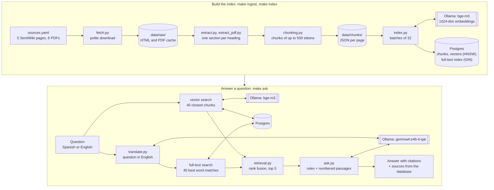
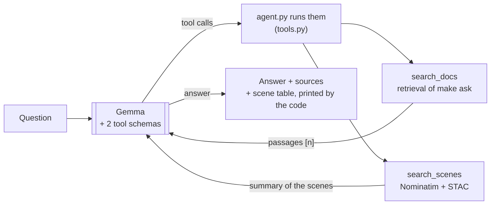
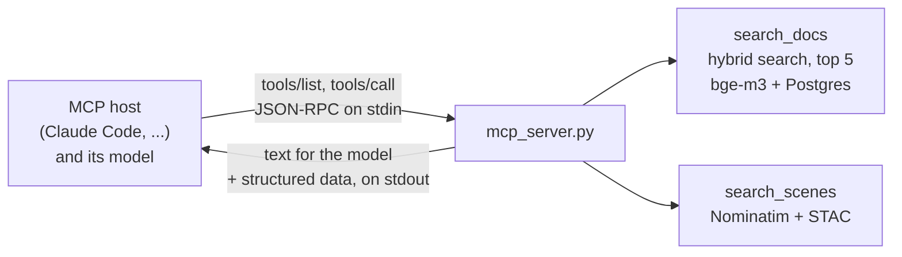

# sentinel1-rag

A small, local and free RAG (retrieval-augmented generation) system that answers technical questions about the Sentinel-1 radar mission (acquisition modes, GRD and SLC products, processing levels, calibration…) from its official documentation: the [Sentinel-1 SentiWiki](https://sentiwiki.copernicus.eu/web/sentinel-1) and six technical documents from its [document library](https://sentiwiki.copernicus.eu/web/s1-documents). Every answer cites the sections it comes from, with links; for a PDF, the link opens it at the right page.

Everything runs on one machine: Ollama serves the embedding model (`bge-m3`) and the language model (`gemma4:e4b-it-qat`), and PostgreSQL stores the chunks with their vectors (pgvector) and a full-text index. Questions can be asked in Spanish or English about the English documentation.

An [agent](#agent-documentation-and-scene-search) (`make agent`) can also search the Copernicus catalogue for the scenes Sentinel-1 acquired over a place and dates, and combine both in one answer. The same two tools are offered to other applications through an [MCP server](#mcp-server) (`make mcp`), so that a host such as Claude Code can search the documentation and the catalogue with its own model.

```
$ make ask Q="¿Cómo se elimina el ruido térmico de un producto GRD de Sentinel-1 y por qué no viene eliminado por defecto?"
Lexical search in English: How is thermal noise removed from a Sentinel-1 GRD product and why is it not removed by default?

La eliminación del ruido térmico de un producto GRD de Sentinel-1 se realiza restando la LUT de ruido
al valor de intensidad del píxel [5]. Para los productos SLC, esto se aplica después de la detección
(pasando de complejo a amplitud) y elevándolo al cuadrado (de amplitud a intensidad) $|DN|^2$ [5].

El ruido térmico no viene eliminado por defecto porque la IPF no lo aplica desde el inicio de la
misión, ya que es una corrección destructiva (no es posible revertir el valor original del píxel) y
para mantener la consistencia con los datos de ERS y Envisat/ASAR donde esta corrección no se aplicó
[5].

Además, el ruido térmico se puede estimar y eliminar opcionalmente para los productos GRD con el fin
de mejorar la calidad de la imagen [2].

Sources:
[2] S1 Processing > L1 Algorithms > Post Processing Algorithms
    https://sentiwiki.copernicus.eu/web/s1-processing#Post-Processing-Algorithms
[5] Thermal Denoising of S-1 Products > 6 Denoising and clipping procedures > 6.1 Denoising procedure
    https://sentiwiki.copernicus.eu/__attachments/a_ab979d8ca949ffba50f47622706a34e8ee5e7afef2989b82c9d4d351d45c492d/DI-MPC-TN-MPC-0392%20-%20Thermal%20Denoising%20of%20Products%20Generated%20by%20Sentinel-1%20IPF%202024%20-%202.3.pdf#page=20

gemma4:e4b-it-qat: 1802 prompt tokens, 181 answer tokens, 7.0s
```

This is real output (line breaks added). The question is in Spanish and the documentation in English: Gemma first translates the question for the keyword half of the search, and the answer comes back in Spanish. Passage [2] is a SentiWiki section; passage [5] comes from a technical note in the document library, and its link opens the PDF at page 20, where that section starts. Each `[n]` points to one of the passages the model was given, and the source list is built by the code from the database, so the model can cite the wrong passage but never invent a section or a URL. Small slips remain, such as the formula written in LaTeX notation (`$|DN|^2$`).

## How it works



**Building the index** happens once, offline:

1. **Download** (`make ingest`): the 5 pages of the Sentinel-1 subtree of the SentiWiki and 6 PDFs from its document library (the radiometric calibration, thermal denoising, GRD border masking and TOPS deramping notes, the geocoding guide and the product definition) are downloaded politely (robots.txt respected, 1 request per second, a User-Agent that names the project) and cached in `data/raw/`, so later runs work offline.
2. **Extract:** each page is split into sections at its headings. Each section keeps its heading path (`S1 Mission > Acquisition Modes > Interferometric Wide Swath`) and its anchor, which becomes the citation link. Tables are kept as one line per row. A PDF has no markup, so its sections are found from the text: a line that starts with a section number ("5.2.1"), is set in a larger font than the body and continues the numbering. Its citation link is the PDF's URL with `#page=N`, the page where the section starts. Running headers and footers, the front matter, chart labels and the unreadable remains of equations are dropped.
3. **Chunk:** a section of up to 500 tokens is one chunk. Longer sections are cut between sentences, table rows or list items into chunks of similar size (up to 400 tokens), each repeating up to 60 tokens of the previous one. The result is 568 chunks from 326 sections: 195 from the SentiWiki and 373 from the PDFs.
4. **Embed and store** (`make index`): each chunk, prefixed with its heading path, is turned into a 1024-number vector by `bge-m3` and stored in Postgres next to its text, section and URL. Postgres also keeps the chunk's words in a full-text index. Indexing is idempotent: a page is re-embedded only when its text, the chunking settings or the embedding model change.

**Answering a question** happens on every `make ask`:

1. **Translate:** Gemma rewrites the question in English for the keyword search, or leaves it as it is when it already is English. This takes about half a second.
2. **Search twice:**
   - *Vector search* embeds the original question with `bge-m3` and takes the 40 chunks with the smallest cosine distance. The model is multilingual, so a Spanish question lands close to the English passage that answers it. An HNSW index is in place, although at 568 chunks Postgres prefers an exact scan, which takes about 4 ms; the index is there to learn how approximate search works.
   - *Full-text search* looks up the English words in the full-text index and takes the 40 chunks with the best BM25 score, which rewards words that are rare in the corpus, stops rewarding a word after a few repetitions and discounts long chunks.
3. **Fuse:** reciprocal rank fusion gives each chunk 1 / (60 + its rank) from each list it appears in, so chunks that both searches rank well come first. The top 5 go to the model.
4. **Answer:** the prompt gives Gemma rules in the system turn (use only the passages, cite them as `[n]`, say when the answer is not there, answer in the question's language) and the 5 numbered passages followed by the question in the user turn.
5. **Cite:** the code reads the `[n]` citations in the answer and prints the cited sections with their URLs.

Every design choice, with the alternatives weighed and what was measured, is recorded in [docs/DECISIONS.md](docs/DECISIONS.md).

## Retrieval results

`make eval` runs 25 labelled questions through the same retrieval that `make ask` uses, translation included, and checks where the sections that answer each question end up in the ranking. With the models loaded it takes about 15 seconds.

- **hit@k:** the share of questions where at least one chunk from a correct section is among the first k results, that is, whether the model received what it needed.
- **MRR@5:** the mean of 1/rank of the first correct chunk (1st scores 1, 2nd 0.5, 4th 0.25), counted as 0 below rank 5 because `make ask` passes only 5 chunks to the model.

| Questions | hit@1 | hit@3 | hit@5 | hit@10 | MRR@5 |
|---|---|---|---|---|---|
| **All (25)** | 0.760 | 0.840 | **0.880** | 0.920 | **0.810** |
| Answer only in the SentiWiki (8) | 0.875 | 1.000 | 1.000 | 1.000 | 0.938 |
| Answer in the SentiWiki and a PDF (11) | 0.818 | 0.909 | 0.909 | 0.909 | 0.864 |
| Answer only in the PDFs (6) | 0.500 | 0.500 | 0.667 | 0.833 | 0.542 |
| Written without reading the documents (5) | 0.600 | 0.800 | 0.800 | 0.800 | 0.700 |
| Drafted from the text (20) | 0.800 | 0.850 | 0.900 | 0.950 | 0.838 |

**hit@5 is 0.880 and MRR@5 0.810 over 25 questions**, from [eval/results/2026-10-11T113743-pdfs.json](eval/results/2026-10-11T113743-pdfs.json). The eval is deterministic: the translations are made at temperature 0, and repeated runs give the same chunks in the same order.

These numbers are the same for [v0.1 and v0.2](#versions): v0.2 adds the agent and the MCP server but does not change the retrieval, and `make eval` on v0.2 returns the same 20 chunks in the same order for all 25 questions, with the same translations ([eval/results/2026-10-11T180312-v0.2.json](eval/results/2026-10-11T180312-v0.2.json)).

How to read these numbers:

- **The 5 questions written without reading the documents are the realistic score.** The other 20 were drafted after reading the sections that answer them, so they reuse the documentation's wording, which makes them easy to find. Each question records how it was written, and the eval reports both groups. Four of the 5 now have PDF sections among their answers, but none is about a topic that only the PDFs cover: the 6 PDF-only questions were drafted from the text.
- **The set is small.** One question moves hit@k by 0.04 overall, by 0.2 within the 5 blind questions and by 0.167 within the 6 PDF questions, so only differences of several questions mean anything.
- **The retrieval was chosen on these same questions.** There is no held-out set. Each change was kept for a reason beyond its number, and checked on real answers (see below).

Each results file holds the rank of every question and the 20 chunks retrieved for it. The labelling rule and the questions left out are described in [D-017](docs/DECISIONS.md#d-017-retrieval-eval-section-level-labels-the-real-retrieval-mrr-cut-at-the-top-k), and the changes for the PDFs in [D-026](docs/DECISIONS.md#d-026-the-eval-with-the-pdfs-labels-on-pdf-sections-matched-with-the-section-path-the-default-retrieval-stays).

### Lexical and hybrid search

The comparisons in this section were made before the PDFs were added, on the 19 questions about the SentiWiki; the [next section](#technical-pdfs) measures the methods again with them.

The retrieval started as vector search alone, first with the top 5 (hit@5 0.895, MRR@5 0.761) and then with the top 10, so that the project's example question would receive the sections that explain SLC and GRD ([D-018](docs/DECISIONS.md#d-018-top-k-raised-from-5-to-10)). It was then compared with Postgres full-text search, ranked first with Postgres's own `ts_rank` and then with BM25, and with a hybrid of vector and full-text search. Because the pages are in English and 12 of the 19 questions are in Spanish, the full-text search was also tried on the question translated into English. With 10 passages each:

| Method (hit@10 / MRR@10) | All (19) | Spanish (12) | English (7) | Blind (5, all Spanish) | hit@3 |
|---|---|---|---|---|---|
| Vector | 0.947 / 0.766 | 0.917 / 0.672 | 1.000 / 0.929 | 0.800 / 0.522 | 0.789 |
| Lexical (`ts_rank`) | 0.737 / 0.500 | 0.583 / 0.284 | 1.000 / 0.871 | 0.600 / 0.158 | 0.579 |
| Lexical (BM25) | 0.684 / 0.559 | 0.500 / 0.302 | 1.000 / 1.000 | 0.400 / 0.300 | 0.632 |
| Lexical, question translated (`ts_rank`) | 0.947 / 0.746 | 0.917 / 0.674 | 1.000 / 0.871 | 0.800 / 0.417 | 0.842 |
| Lexical, question translated (BM25) | 0.947 / 0.796 | 0.917 / 0.676 | 1.000 / 1.000 | 0.800 / 0.357 | 0.842 |
| Hybrid (RRF, `ts_rank`) | 0.842 / 0.633 | 0.750 / 0.461 | 1.000 / 0.929 | 0.600 / 0.329 | 0.684 |
| Hybrid, full-text half translated (`ts_rank`) | 0.947 / 0.860 | 0.917 / 0.819 | 1.000 / 0.929 | 0.800 / **0.667** | **0.947** |
| Hybrid, full-text half translated (BM25) | 0.947 / **0.908** | 0.917 / **0.854** | 1.000 / **1.000** | 0.800 / 0.650 | 0.895 |

Then the answers themselves were compared: the 19 questions plus two that the documentation does not answer, twice each.

| Configuration | Answers citing a correct section | Median prompt | Median answer time |
|---|---|---|---|
| Vector, top 10 (the default until step 10) | 36 of 38 | 2,851 tokens | 5.4 s |
| Hybrid, translated, top 10, `ts_rank` | 36 of 38 | 3,147 tokens | 6.2 s |
| Hybrid, translated, top 5, `ts_rank` | 36 of 38 | 1,615 tokens | 3.7 s |
| Hybrid, translated, top 3, `ts_rank` | 36 of 38 | 1,042 tokens | 2.7 s |
| **Hybrid, translated, top 5, BM25 (the default)** | 36 of 38 | 1,583 tokens | 3.7 s |

The last row comes from a second run of the experiment, side by side with the `ts_rank` top 5 again, which gave the same counts and prompt sizes as the first time.

What the comparison showed:

- **Lexical search cannot cross languages.** On its own, a Spanish question only matches the chunks through acronyms, numbers and "Sentinel-1". The acronyms that were expected to favour it are also too common here, with "GRD" in 43 of the 195 chunks and "SLC" in 47. Postgres's `ts_rank` also has no notion of how rare a word is (no IDF); BM25 does, but it cannot fix the language gap either (hit@10 0.684 without translation).
- **Fusing a weak list with a strong one hurts.** Without translation, the hybrid improved 2 questions and worsened 6, because RRF rewards chunks that both lists rank, even poorly.
- **Translation fixes the lexical half.** Translated, full-text search matches vector search on hit@10, and the hybrid ranks the right section first for 15 of the 19 questions (hit@1 0.789 against 0.684).
- **Better ranking allows fewer passages.** The translated hybrid gets as many answers into its top 5, or even its top 3, as vector search does into its top 10. The answers cite a correct section just as often, the prompt is about 40 % shorter and generation about 30 % faster, and some answers are more focused. The top 5 rather than 3 keeps the breadth of the old answers (1.8 sections cited per answer, against 1.4 with 3) and leaves a margin for new questions whose answer ranks 4th or 5th.
- **The cost is one question and one model call.** The project's original example, "¿Qué diferencia hay entre un producto GRD y uno SLC?", loses the section that explains SLC (see [Limitations](#limitations)). The translation adds 0.2–0.7 s.
- **BM25 ranks better, but the answers stay the same.** With BM25 instead of `ts_rank`, the right section comes first for 17 of the 19 questions instead of 15, and every English question is answered from rank 1. The same 18 questions reach the model, and the answers cite a correct section just as often. BM25 is the default because it fixes `ts_rank`'s blindness to common words and is the standard ranking for this kind of search, not because the answers improved.

The details, including other ranking variants, are in [D-019](docs/DECISIONS.md#d-019-lexical-retrieval-with-postgres-full-text-search) to [D-023](docs/DECISIONS.md#d-023-bm25-in-sql-ranks-the-full-text-search); the runs are in [eval/results/](eval/results/).

### Technical PDFs

Six PDFs from the Sentinel-1 document library were then added: short technical notes on radiometric calibration, thermal noise removal, the no-value pixels at the edges of GRD products and TOPS deramping, a guide to geocoding, and the 130-page product definition. They make up 373 of the 568 chunks. The 19 earlier questions were checked against them, and 11 gained PDF sections that answer them as well; six new questions were drafted from the PDFs, one per document.

| Method, top 5 (hit@5 / MRR@5) | All (25) | Answer only in the SentiWiki (8) | In both (11) | Only in the PDFs (6) | Blind (5) |
|---|---|---|---|---|---|
| **Hybrid, translated, BM25 (the default)** | **0.880 / 0.810** | 1.000 / 0.938 | 0.909 / 0.864 | 0.667 / 0.542 | 0.800 / 0.700 |
| Vector | 0.800 / 0.673 | 1.000 / 0.760 | 0.727 / 0.682 | 0.667 / 0.542 | 0.600 / 0.367 |
| Lexical, translated, BM25 | 0.800 / 0.663 | 1.000 / 0.906 | 0.818 / 0.576 | 0.500 / 0.500 | 0.600 / 0.200 |
| Hybrid, not translated | 0.720 / 0.590 | 0.625 / 0.625 | 0.818 / 0.652 | 0.667 / 0.431 | 0.600 / 0.367 |

And the answers, before the PDFs and with them, for the 25 questions and the two that the documentation does not answer, twice each:

| | Earlier questions citing a correct section | PDF questions citing a correct section | Median prompt | Median answer time |
|---|---|---|---|---|
| Before (SentiWiki only) | 36 of 38 | 0 of 12 | 1,534 tokens | 3.4 s |
| With the PDFs | 36 of 38 | 8 of 12 | 1,570 tokens | 4.2 s |

What the comparison showed:

- **The earlier questions keep their score.** The same 18 of 19 reach the model, and the answers cite a correct section just as often, though 22 of those 38 answers now also cite a PDF. "¿Qué información contiene un producto Sentinel-1 SLC?" gains the most: the product definition's section on SLC products now ranks first, and the answer explains the complex samples with amplitude and phase. Scored with the old labels, the eval would have shown a drop (hit@5 0.895) only because it would not count these PDF sections.
- **The PDF questions are answered when their section is found.** Four of the six reach the model, and their answers cite the right note every time: how thermal noise is subtracted and why the processor does not do it by default, why GRD products have no-value pixels at near range, how DEM height errors shift a geocoded image, and the GRD resolution classes with their values.
- **Two misses show the usual failure modes.** "Sigma cero" is translated as "sigma zero", which pulls in the sections on the *Noise Equivalent Sigma Zero*, while the calibration note talks about σ0, digital numbers and calibration LUTs. And for why TOPS bursts must be deramped, the four chunks of the note's long definition section fill the top places, pushing its introduction, which says why, to 10th.
- **Documents can disagree.** For orbit files, the answer took the latencies from the geocoding guide (restituted orbits about 3 hours after acquisition) and the accuracies from the wiki, whose table gives 45 minutes for the same product.
- **The default stays.** Hybrid search with the translated question is still the best of the methods at 5 passages.

The details are in [D-024](docs/DECISIONS.md#d-024-six-technical-pdfs-from-the-sentinel-1-document-library-join-the-corpus) to [D-026](docs/DECISIONS.md#d-026-the-eval-with-the-pdfs-labels-on-pdf-sections-matched-with-the-section-path-the-default-retrieval-stays).

## Agent: documentation and scene search

`make agent` answers with a small agent instead of a fixed pipeline. Gemma gets the question and two tools, and decides which to call:

- **`search_docs(query)`** runs the retrieval of `make ask` and returns numbered passages to cite.
- **`search_scenes(place, start, end, ...)`** finds the place with OpenStreetMap's geocoder (Nominatim) and searches the [Copernicus Data Space Ecosystem STAC catalogue](https://stac.dataspace.copernicus.eu/v1) for Sentinel-1 GRD or SLC scenes over it, optionally filtered by acquisition mode and orbit direction.

```
$ make agent Q="Are there Sentinel-1 scenes of Rotterdam from the last week, and what does the IW mode acquire?"
Asking gemma4:e4b-it-qat, with tools...
Turn 1: 2 tool calls (2.0s)
  search_scenes({"days": 7, "place": "Rotterdam, Netherlands", "start": "2026-10-04"})  0.5s
    -> Found: 5 scenes, from 5 passes of a satellite over the place.
  search_docs({"query": "Sentinel-1 IW mode acquisition"})  0.7s
    -> passages [1] [2] [3] [4] [5]
Turn 2: answer (7.6s)

The search for Sentinel-1 scenes of Rotterdam from the last week found 5 scenes, covering the period
from 2026-10-05 to 2026-10-11, with acquisitions from Sentinel-1C and Sentinel-1D in both ascending
and descending orbits, all in the IW VV+VH mode.

The Sentinel-1 IW mode acquires data using the Interferometric Wide Swath (IW) mode, which is the
primary mode over land and satisfies most service requirements [2][5]. It uses the TOPSAR imaging
technique, which consists of three sub-swaths [3][5]. With TOPSAR, the radar beam is electronically
steered from backward to forward in the azimuth direction for each burst, which results in a higher
quality image with uniform NESZ and ambiguity levels within the scan bursts [3][5]. [...]

Sources:
[2] S1 Mission > Acquisition Modes
    https://sentiwiki.copernicus.eu/web/s1-mission#Acquisition-Modes
[3] Sentinel-1 Product Definition > 3 SENTINEL-1 MISSION AND SAR SYSTEM OVERVIEW > 3.3 Sentinel-1 Acquisition Modes > 3.3.2 Interferometric Wide Swath Mode (IW)
    https://sentiwiki.copernicus.eu/__attachments/.../S1-RS-MDA-52-7440-Sentinel-1-Product-Definition-2.11.pdf#page=30
[5] S1 Mission > Acquisition Modes > Interferometric Wide Swath
    https://sentiwiki.copernicus.eu/web/s1-mission#Interferometric-Wide-Swath

Scenes: GRD scenes over Rotterdam, Zuid-Holland, Nederland, 2026-10-04 to 2026-10-11 (any mode, both orbit directions)
  2026-10-11 05:57  S1C IW  VV+VH  descending track 110  S1C_IW_GRDH_1SDV_20261011T055745_20261011T055810_009833_01397D_ADF1_COG
  2026-10-09 17:24  S1C IW  VV+VH  ascending  track 88   S1C_IW_GRDH_1SDV_20261009T172409_20261009T172434_009811_0138B0_B740_COG
  [3 more]
  Metadata of a scene: https://stac.dataspace.copernicus.eu/v1/collections/sentinel-1-grd/items/<name>

Places geocoded with Nominatim. Data © OpenStreetMap contributors, ODbL.

gemma4:e4b-it-qat: 2 turns, 2492 prompt tokens in the last one; 9.6s in the model, 1.1s in the tools
```

This is real output, shortened where marked. The model asked for both searches in its first turn and answered in its second. For "the last week" it sent `days: 7` and also a `start`; `days` wins, and the code counts the dates. As in `make ask`, the sources and the scene table are printed by the code from what the tools returned; the model only sees a summary of the scenes, never their names.

### How the loop works



Ollama never runs anything: it returns the calls the model wants (`message.tool_calls`), and `agent.py` runs them, appends each result to the conversation as a `tool` message and asks again, for at most 5 turns. The loop is written by hand, in about 50 lines, without an agent framework.

A model with about 4.5B effective parameters followed the prompt's rules only some of the time, so the behaviours that matter are enforced by the code or by the shape of the tools ([D-027](docs/DECISIONS.md#d-027-an-agent-with-two-tools-search_docs-and-search_scenes-in-a-hand-written-loop)):

- **No answers from memory:** if the model answers before calling any tool, the loop discards the answer and searches the documentation with the question. Without this, it answered "What is the IW mode?" wrongly from memory, and said "not in the documentation" without having looked.
- **No date arithmetic:** for "the last 10 days" the model passes `days: 10` and the code counts back. Asked for dates, it had searched 20 days.
- **No invented filters:** `mode` and `orbit` take `any` as an explicit value. Without it, the model added IW, and once SM, which found nothing.
- **Wrong places are questioned:** "Doñana, Spain" is a peak in Almería for the geocoder and "Delta del Ebro, Spain" a street. A place under 1 km across makes the tool return an error asking for a more precise name, and errors name what is wrong, so the model can correct its call ([D-028](docs/DECISIONS.md#d-028-places-are-geocoded-with-nominatim-inside-search_scenes)).
- **Scene results are not passages:** every scene search result says it has no number to cite. Before that line, the model cited "[1]" after scene facts in half of the answers about scenes only.

### Agent results

`make eval-agent` asks the agent 18 questions (5 about the documentation, 8 about scenes, 5 mixed) with the real tools, and checks its calls rather than the scenes, which change every day: the right tools, the right arguments (product type, dates, filters), a place that contains the expected point, a labelled section among the passages read, citations only when the documentation answers, and an answer that is not empty. "Today" is fixed in the question file, so "last month" has one right answer. The 6 `held-out` questions were written after the first run and never used to change the prompt or the tools; the 12 `tuning` questions were.

| Run | All (18) | Tuning (12) | Held-out (6) | Median time per question |
|---|---|---|---|---|
| First design | 10 | 6 | 4 | 7.3 s |
| **Final** | **13** | 8 | **5** | 5.9 s |
| Final, with thinking (`--think`) | 13 | 8 | 5 | 15.1 s |
| v0.2, with the check for empty answers | 13 | 8 | 5 | 5.2 s |

From [eval/results/2026-10-11T152216-agent-final.json](eval/results/2026-10-11T152216-agent-final.json); the details, including each tuning iteration, are in [D-029](docs/DECISIONS.md#d-029-the-agent-eval-checks-tool-calls-with-tuning-and-held-out-questions).

- **The fixes traded failures before they reduced them.** The stricter prompt stopped the answers from memory and the wrong dates, but made the model cite "[1]" after scene facts. That only showed up when reading the answers, so the eval gained a check for it, and the tool's result a line against it.
- **What still fails:** one answer about scenes that still cites "[1]", two mixed questions with an ambiguous place ("Doñana", "delta del Ebro"), where the model reports the geocoder's error instead of searching again, and two retrieval misses inherited from `make ask` (thermal noise, and GRD versus SLC). The first design had reported the scenes of the wrong Doñana as if they were right; now the answer says the place was not found.
- **Thinking** passes the same questions in about 2.6 times the time, so it stays off. It needed no forced search: thinking first, the model searched the documentation by itself for the two questions it cannot answer.
- **18 questions are few,** all drafted by the same author as the fixes, and one held-out question moves that score by 0.167. Runs are not exactly repeatable: a second run gave the same checks but differently worded answers.
- **v0.2 found an empty answer.** The first run on v0.2 counted 14, but one of them was an empty answer: for "¿Hay imágenes Sentinel-1 GRD de Madrid de la última semana?" Gemma now ends its turn without writing anything, with the code of v0.1 too, and an empty answer passed the citation check because it cites nothing. The eval now also checks that there is an answer, which gives 13 again ([eval/results/2026-10-12T143532-agent-v0.2-answered.json](eval/results/2026-10-12T143532-agent-v0.2-answered.json)), and `make agent` says when the answer is empty. Asking the model again after an empty answer is left for later ([D-033](docs/DECISIONS.md#d-033-the-agent-eval-fails-empty-answers-and-make-agent-says-when-the-answer-is-empty)).

## MCP server

`make mcp` runs an [MCP](https://modelcontextprotocol.io) (Model Context Protocol) server that offers the agent's two tools to any MCP host, such as Claude Code or Claude Desktop. The host starts the server as a subprocess and sends it JSON-RPC messages on its stdin, one per line: `tools/list` returns the tools with their JSON Schemas, and `tools/call` runs one. The host's own model decides when to call them, as Gemma does in `make agent`.



It is built on the official [Python SDK](https://github.com/modelcontextprotocol/python-sdk) (`mcp` 2.3), which serves both kinds of client: those that open with the `initialize` handshake of protocol revisions up to 2025-11-25, and those that send their version and capabilities with every request, as revision 2026-07-28 does ([D-031](docs/DECISIONS.md#d-031-an-mcp-server-on-stdio-built-on-the-official-sdks-low-level-server)).

### Connecting a host

Claude Code finds the server in `.mcp.json`, in the repository root, and asks before using it:

```json
{
  "mcpServers": {
    "sentinel1-rag": {
      "command": "uv",
      "args": ["run", "--directory", "${CLAUDE_PROJECT_DIR:-.}", "python", "-m", "sentinel1_rag.mcp_server"]
    }
  }
}
```

Another host needs the same command with the repository's path: `uv run --directory /path/to/sentinel1-rag python -m sentinel1_rag.mcp_server`. Postgres (`make up`) and Ollama with bge-m3 must be running; the server does not use Gemma.

### What changes from the agent's tools

The arguments are the agent's, built from the same JSON Schemas, and so are the checks and the error messages. What changes comes from talking to hosts and models that this project does not control ([D-032](docs/DECISIONS.md#d-032-the-servers-tools-stand-alone-on-every-call-and-the-hosts-model-writes-the-query-in-english)):

- **Every call stands alone.** Protocol revision 2026-07-28 has no sessions, so the server keeps nothing from one call to the next. Passages are numbered within each result and carry their section and URL, for the host's model to cite. A place under 1 km across is sent back with an error unless the call says `confirm_place: true`, where the agent accepted the same place asked for twice.
- **The host's model writes the query in English,** the language of the documents, and the server runs the default retrieval with it, without translating. Measured on the 25 eval questions, with Gemma's translations standing in for the host's, it finds the same 22 in the top 5, through the protocol too. A query in another language weakens the full-text half of the search.
- **Each result has text for the model and structured data** (`structuredContent`) that matches the tool's declared `outputSchema`: the passages with section and URL, or the place found and the scenes with their product names. The scene names are in the text as well: they were hidden from Gemma only because it copied them slowly.
- **Errors the model can fix are results** marked `isError` (a wrong argument, a bad date, a place not found); an unknown tool is a protocol error.
- **The host decides.** The agent's forced documentation search and its system prompt do not exist here; the server sends a few lines of `instructions`, which the host may pass to its model or not.

### Checking it

`make mcp-check` starts the server as a host would and checks it through the SDK's client: 6 checks with the handshake and 13 with per-request metadata, all passing, in about 7 seconds. They cover the server's name and instructions, the tools and their arguments, 5 passages with their section and URL, 10 scenes over Rotterdam in September 2026 with their names, the errors for an unknown argument, a bad date and a small place (twice in a row, since nothing is remembered), the small place searched with `confirm_place`, and the protocol error for an unknown tool.

```
Per-request metadata: protocol 2026-07-28
  ok   server: sentinel1-rag 0.2.0
  ok   instructions sent
  ok   tools: search_docs, search_scenes
  ok   search_docs: the agent's arguments: query
  ok   search_scenes: the agent's arguments: place, start, end, days, product_type, mode, orbit, confirm_place
  ok   search_docs: passages with section and URL: [1] S1 Mission > Acquisition Modes > Interferometric Wide Swath
  ok   search_scenes: place, summary and table: 10 scenes over Rotterdam, Zuid-Holland, Nederland
  ok   unknown argument -> isError: Error: wrong arguments for search_scenes: got an unexpected keyword argument 'radius'.
  [...]
  ok   unknown tool -> protocol error: -32602 Unknown tool: search_everything
```

**With Claude Code as the host,** in a new session in the repository, four questions went through 7 calls, all answered ([D-031](docs/DECISIONS.md#d-031-an-mcp-server-on-stdio-built-on-the-official-sdks-low-level-server)). Claude Code passes the structured data to its model, not the text. For "¿Qué diferencia hay entre un producto GRD y uno SLC?" its model searched twice, in English, and the second, more specific query found the product definition's section on SLC products (complex values with amplitude and phase), which the single search of `make ask` misses for this question. For "Doñana" it got the small-place error and searched again with the national park's name. The first connection after a reboot took 4.7 s, because the server was slow to start from a cold disk and Claude Code's first probe timed out; it recovered by itself. The host's model knew how the server was designed, so this shows that the server works in a real host, not how any model would use it.

The server writes nothing but protocol messages on stdout, where a stray line would break the host's reading of it. Its log goes to stderr: the protocol revision the client speaks, and one line per call.

## Running it on WSL

It was built and tested on Windows 10 with WSL2 (Ubuntu 24.04), an NVIDIA GTX 1070 with 8 GB of VRAM and 12 GB of RAM for WSL (10 GB until step 13). It has not been tested on other machines, or with Ollama running on the CPU only.

### Requirements

- **Docker Engine** with the Compose plugin, running inside WSL (tested with Engine 29.8 and Compose 5.5).
- **[uv](https://docs.astral.sh/uv/)**, GNU Make and git. uv installs Python 3.12 and the dependencies on the first run.
- **[Ollama](https://ollama.com) 0.30.5 or newer**, installed inside WSL (tested with 0.40.1). On WSL2 it reaches the GPU through the Windows NVIDIA driver, which is the only thing needed on the Windows side. Ollama supports Pascal cards such as the GTX 1070 from driver 570 on.
- **GPU memory and disk:** with both models loaded, the test machine used 5.4 of its 8 GiB of VRAM, desktop included. The models take 7.3 GB of disk, and the downloaded pages and PDFs 18 MB.

### Setup

```bash
# Ollama and the two models (7.3 GB in total)
curl -fsSL https://ollama.com/install.sh | sh
ollama pull gemma4:e4b-it-qat
ollama pull bge-m3

# The project
git clone https://github.com/mmartinsie/sentinel1-rag.git
cd sentinel1-rag
make up       # Postgres + pgvector in Docker, waits until it accepts connections
make ingest   # downloads the 5 pages and 6 PDFs into data/raw/ and chunks them into data/chunks/
make index    # embeds the 568 chunks and stores them in Postgres
make ask Q="¿Qué diferencia hay entre un producto GRD y uno SLC?"
make eval     # retrieval metrics (translates the questions with Gemma), saved in eval/results/
make agent Q="¿Hay imágenes Sentinel-1 de Madrid de la última semana?"
make eval-agent   # the agent's tool calls on 18 questions; needs the network
make mcp-check    # starts the MCP server and checks its tools through the protocol; needs the network
```

Measured on a clean clone before the PDFs were added: `make up` 13 s and the first `make ask` about 70 s, almost all of it loading Gemma from a hard disk. With the PDFs, `make ingest` takes about 80 s, most of it reading the PDFs, and `make index` about a minute for the 568 chunks into an empty database. With the models loaded, an answer takes about 4–7 s, and up to about 16 s when it is long. Ollama unloads a model after 5 idle minutes, so the next question pays the load time again.

To check that the models run on the GPU, run `ollama ps` while asking a question: both models should show `100% GPU`. After a WSL restart, Ollama sometimes falls back to the CPU because its GPU discovery times out while the disk is cold. If `journalctl -u ollama -b | grep "inference compute"` shows `library=cpu`, read its CUDA libraries into the disk cache with `cat /usr/local/lib/ollama/cuda_v12/* > /dev/null` and run `sudo systemctl restart ollama`.

Every request asks Ollama to map the model files (`use_mmap`) instead of copying them into RAM. Ollama turns mapping off on its own when it sees little free memory, which made Gemma's process grow from about 3 to 6 GB and froze WSL once ([D-030](docs/DECISIONS.md#d-030-every-ollama-request-asks-for-mmap)).

### Commands

| Command | What it does |
|---|---|
| `make up` | Starts Postgres + pgvector and waits until it is ready. The database listens on `127.0.0.1:5432` only. |
| `make down` | Stops the database. The data is kept. |
| `make ingest` | Downloads the pages and PDFs in `sources.yaml` (once; cached in `data/raw/`) and writes the chunks to `data/chunks/`. |
| `make index` | Embeds the chunks and stores them. Pages that have not changed are skipped. |
| `make ask Q="..."` | Answers a question with cited sources. `ARGS=--show-context` also prints the retrieved chunks and their scores. `--method vector`, `lexical` or `hybrid`, `--no-translate`, `--top-k N` and `--lexical-ranking ts_rank` change the retrieval; the default is hybrid, translated, BM25, top 5. |
| `make eval` | Measures retrieval, with the same defaults and options as `make ask`. `ARGS="--label name"` names the run. |
| `make agent Q="..."` | Answers with the agent, which can search the documentation and the scene catalogue. `ARGS` takes `--show-results` (print what each tool returned), `--today YYYY-MM-DD` and `--think`. |
| `make eval-agent` | Checks the agent's tool calls on `eval/agent_questions.yaml`. `ARGS` takes `--label name`, `--think`, `--set tuning` or `held-out`, and `--only id ...`. |
| `make mcp` | Runs the MCP server on stdio. A host starts it (see [Connecting a host](#connecting-a-host)); run by hand, it waits for messages on stdin. |
| `make mcp-check` | Starts the MCP server and checks its tools through the protocol, with both kinds of client. |
| `make clean` | Stops the database and deletes its volume and `data/`. |

The defaults work without configuration. `OLLAMA_URL` and `DATABASE_URL` override where the code finds Ollama and Postgres, `STAC_URL` and `NOMINATIM_URL` the catalogue and the geocoder, and `POSTGRES_USER`, `POSTGRES_PASSWORD`, `POSTGRES_DB` and `POSTGRES_PORT` in a `.env` file override the database settings.

## Project layout

```
sources.yaml              the pages and PDFs in the corpus
db/schema.sql             tables, constraints, the HNSW index and the full-text index
src/sentinel1_rag/
  fetch.py                polite downloader with a local cache
  extract.py              HTML to sections with heading paths and anchors
  extract_pdf.py          PDF to sections with heading paths and page anchors
  chunking.py             sections to chunks
  ingest.py               make ingest
  ollama.py               minimal REST client for /api/embed and /api/chat
  db.py                   database connection
  index.py                make index
  retrieval.py            vector, lexical and hybrid top-k search, shared by ask and eval
  translate.py            translates a question into English for the lexical search
  ask.py                  make ask: prompt, answer and citations
  evaluate.py             make eval
  agent.py                make agent: the agent loop and its output
  tools.py                the agent's tools and their JSON Schemas
  scenes.py               search of the Copernicus STAC catalogue
  geocode.py              place names to bounding boxes with Nominatim, cached
  evaluate_agent.py       make eval-agent
  mcp_server.py           make mcp: the tools served over MCP
  mcp_check.py            make mcp-check
eval/questions.yaml       25 questions labelled with the sections that answer them
eval/agent_questions.yaml 18 questions with the tool calls expected from the agent
eval/results/             the eval runs cited in the docs
docs/DECISIONS.md         every decision, its alternatives and what was verified
docs/steps/               a plain-English write-up of each build step
docs/PROGRESS.md          build log and notes for resuming work
.mcp.json                 registers the MCP server for Claude Code
```

## Limitations

- **Small eval set.** 25 questions, only 5 of them written without reading the documents (none about the PDFs), and no held-out set (see [Retrieval results](#retrieval-results)).
- **The example question misses its best sections.** For "¿Qué diferencia hay entre un producto GRD y uno SLC?", chunks that list the product types and their resolutions outrank the sections that explain the difference, in the SentiWiki and in the product definition alike: the first of those ranks 13th. The answer covers slant versus ground range and the resolution classes, but not the phase information that SLC products keep. Vector search with 10 passages reaches one of them, 10th: `make ask Q="..." ARGS="--method vector --top-k 10"`.
- **Questions about three or more things.** One search cannot get every part into the passages the model sees. For "the differences between Level-0, Level-1 and Level-2", vector search ranked the three sections 2nd, 3rd and 14th.
- **No threshold for "not found".** The distances of unanswerable questions overlap with those of answerable ones, so the model always receives 5 passages and has to decide on its own that the answer is not there. It did so every time for the question about the mission's cost.
- **Retrieval depends on the language model.** Gemma translates every question before the full-text search: one more call, and a wrong translation would quietly weaken that half of the search. English questions are usually recognised and left alone; one of the seven in the eval came back with "Which" changed to "What".
- **Partial answers do not say what is missing.** "¿Cómo se exportan los resultados a GeoTIFF?" is not answered by the documentation. Gemma replies with nearby facts (the products are GeoTIFF files), correctly cited, but does not say that the export itself is not covered, although the prompt asks it to.
- **A small model.** `gemma4:e4b-it-qat` has about 4.5B effective parameters. Answers can be shallow, vary slightly between runs (temperature 0.2, no fixed seed), render technical terms loosely in Spanish (once "Single Look Complex" as "Complejo de Aspectos Únicos") and have small formatting quirks, such as `$180^\circ$` instead of 180°.
- **A frozen, site-specific corpus.** Cached pages and PDFs are never refreshed: delete `data/raw/` or run `make clean` to download them again. Each PDF is pinned to one issue in `sources.yaml`, so newer issues are only picked up by editing it. The HTML extractor is written for the SentiWiki's layout and stops with "unexpected page layout" if it changes.
- **PDFs lose their equations.** Their fonts do not say which character each glyph is, so formulas disappear and only the text around them remains: the calibration note's σ0 = |DN|² / A²σ is not in the index. Charts keep their captions and a few stray labels.
- **The PDF extractor is tuned on six documents.** It finds sections by their numbering and a larger font; a PDF with unnumbered headings, headings in the body font or two columns would need new rules, and it stops with "no numbered sections found" rather than guess.
- **Citations to a PDF point to a page, not a heading.** Sections that start on the same page share the same link; the section path printed next to it tells them apart.
- **Words matter.** A question has to use roughly the documentation's terms: "sigma zero" finds the noise-equivalent sigma zero sections instead of the calibration note, which says σ0, DN and calibration LUT.
- **Long sections crowd out short ones.** A section cut into several chunks can fill most of the 5 places: for why TOPS bursts are deramped, the definition's four chunks come first and the introduction that answers the question ranks 10th.
- **Documents of different dates can disagree,** as the geocoding guide (2022) and the wiki do on orbit file latency, and the model may mix them in one answer.
- **HNSW is not needed at this size.** With 568 chunks the Postgres planner prefers an exact scan (about 4 ms). The index is there to learn how it works.
- **BM25 is computed the slow way.** Postgres has no BM25, so the SQL works out the corpus statistics (how many chunks contain each word, the average chunk length) on every query, reading every chunk. It took about 16 ms with the 195 SentiWiki chunks and takes about 41 ms with 568, so it would not scale to a large corpus, which would need those statistics kept in a table or an index built for BM25.
- **The agent's guards come from 18 questions.** A small model followed its prompt only some of the time, so the code enforces grounding, dates and filters (see [Agent](#agent-documentation-and-scene-search)). Small prompt changes moved single questions both ways, and only 6 questions were held out.
- **Ambiguous place names.** The geocoder's first match is used. A wrong match under 1 km across is caught, but a wrong town would not be, except by reading the place printed with the scenes. In a question that also asks about the documentation, the model reports a rejected place instead of searching again.
- **Scene searches need the network** (the Copernicus catalogue and Nominatim) and stop at the 10 newest scenes. Products cannot be downloaded: that needs a Copernicus account.
- **The MCP server runs on stdio only,** so the host must run on the same machine, inside WSL, and calls are served one at a time. It has no Streamable HTTP transport and no authentication.
- **The MCP host's model decides how the tools are used.** The server asks for English queries and explains its tools, but cannot enforce what the agent's loop enforces, such as searching the documentation before answering.
- **No automated tests.** The checks run while building it are recorded under "Verified" in [docs/DECISIONS.md](docs/DECISIONS.md).

## Extensions (not implemented)

Four of the five planned extensions are done: a lexical baseline and hybrid search, which with a translated question is now the default (see [Lexical and hybrid search](#lexical-and-hybrid-search)), technical PDFs from the Sentinel-1 document library (see [Technical PDFs](#technical-pdfs)), an agent with a `search_scenes` tool over the Copernicus STAC API (see [Agent](#agent-documentation-and-scene-search)), and an MCP server that offers its tools to other applications (see [MCP server](#mcp-server)). The last one:

1. **OpenSearch k-NN** instead of pgvector, comparing results.

Smaller experiments that `make eval` can measure in minutes, not run yet: merging the chunks under 100 tokens with their neighbours, another chunk size, embedding chunks without the heading-path prefix, at most two chunks per section in the top 5, adding the SentiWiki's POD or Glossary pages, more PDFs from the library, and a reranker over the top 20.

## Versions

| Version | What it contains |
|---|---|
| [v0.1](https://github.com/mmartinsie/sentinel1-rag/tree/v0.1) | The RAG over the SentiWiki and six technical PDFs: hybrid search with the question translated for BM25, top 5, page-cited answers, and the retrieval eval. |
| [v0.2](https://github.com/mmartinsie/sentinel1-rag/tree/v0.2) | Adds the agent with scene search (`make agent`, `make eval-agent`) and the MCP server (`make mcp`, `make mcp-check`). The retrieval is unchanged: `make eval` gives the same results as in v0.1 (see [Retrieval results](#retrieval-results)). |

## License

The code is under the [MIT License](LICENSE). The SentiWiki documentation, including the PDFs of its document library, is not part of this repository: `make ingest` downloads it from the site, and it belongs to its publishers. The agent's scene metadata comes from the Copernicus Data Space Ecosystem, and its place names from [OpenStreetMap](https://www.openstreetmap.org/copyright) through Nominatim (© OpenStreetMap contributors, ODbL), used under the [Nominatim usage policy](https://operations.osmfoundation.org/policies/nominatim/).
