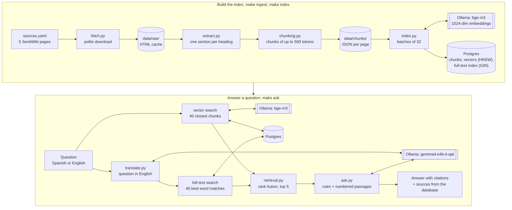

# sentinel1-rag

A small, local and free RAG (retrieval-augmented generation) system that answers technical questions about the Sentinel-1 radar mission (acquisition modes, GRD and SLC products, processing levels…) using the [Sentinel-1 SentiWiki](https://sentiwiki.copernicus.eu/web/sentinel-1) as its only source. Every answer cites the sections it comes from, with links.

Everything runs on one machine: Ollama serves the embedding model (`bge-m3`) and the language model (`gemma4:e4b-it-qat`), and PostgreSQL stores the chunks with their vectors (pgvector) and a full-text index. Questions can be asked in Spanish or English about the English documentation.

```
$ make ask Q="¿Cómo se detectan los vertidos de petróleo en el mar con Sentinel-1 y qué productos conviene usar?"
Lexical search in English: How are oil spills detected at sea with Sentinel-1 and which products should be used?

Los vertidos de petróleo se detectan en imágenes SAR como características oscuras distintivas [1].

Para la detección de vertidos de petróleo, se pueden utilizar los siguientes productos:
*   Se pueden usar los productos GRD IW y EW en polarización dual para la detección de fugas de
    petróleo que ocurren naturalmente desde el lecho marino [1].
*   Los sistemas SAR, como los de Sentinel-1, pueden ofrecer información clave sobre el seguimiento
    de derrames de petróleo en el océano [2].
*   Los estimadores de SSW derivados de SAR son importantes en el monitoreo de derrames de petróleo,
    ya que ayudan a diferenciar los simulacros de los derrames reales [5].

Además, las detecciones de vertidos pueden correlacionarse con la información de transmisiones del
Sistema de Identificación Automática (AIS) de los barcos, lo cual es posible con Sentinel-1C y
Sentinel-1D [1].

Sources:
[1] S1 Applications > Maritime Monitoring > Oil Pollution Monitoring
    https://sentiwiki.copernicus.eu/web/s1-applications#Oil-Pollution-Monitoring
[2] S1 Applications > Overview of S1 Applications
    https://sentiwiki.copernicus.eu/web/s1-applications#Overview-of-S1-Applications
[5] S1 Applications > Maritime Monitoring > Marine Waves and Winds
    https://sentiwiki.copernicus.eu/web/s1-applications#Marine-Waves-and-Winds

gemma4:e4b-it-qat: 1671 prompt tokens, 198 answer tokens, 4.7s
```

This is real output (line breaks added). The question is in Spanish and the documentation in English: Gemma first translates the question for the keyword half of the search, and the answer comes back in Spanish. Each `[n]` points to one of the passages the model was given, and the source list is built by the code from the database, so the model can cite the wrong passage but never invent a section or a URL. Small slips remain: "simulacros" is a loose rendering of the documentation's "look-alike", which it contrasts with actual spills.

## How it works



**Building the index** happens once, offline:

1. **Download** (`make ingest`): the 5 pages of the Sentinel-1 subtree of the SentiWiki are downloaded politely (robots.txt respected, 1 request per second, a User-Agent that names the project) and cached in `data/raw/`, so later runs work offline.
2. **Extract:** each page is split into sections at its headings. Each section keeps its heading path (`S1 Mission > Acquisition Modes > Interferometric Wide Swath`) and its anchor, which becomes the citation link. Tables are kept as one line per row.
3. **Chunk:** a section of up to 500 tokens is one chunk. Longer sections are cut between sentences, table rows or list items into chunks of similar size (up to 400 tokens), each repeating up to 60 tokens of the previous one. The result is 195 chunks from 89 sections.
4. **Embed and store** (`make index`): each chunk, prefixed with its heading path, is turned into a 1024-number vector by `bge-m3` and stored in Postgres next to its text, section and URL. Postgres also keeps the chunk's words in a full-text index. Indexing is idempotent: a page is re-embedded only when its text, the chunking settings or the embedding model change.

**Answering a question** happens on every `make ask`:

1. **Translate:** Gemma rewrites the question in English for the keyword search, or leaves it as it is when it already is English. This takes about half a second.
2. **Search twice:**
   - *Vector search* embeds the original question with `bge-m3` and takes the 40 chunks with the smallest cosine distance. The model is multilingual, so a Spanish question lands close to the English passage that answers it. An HNSW index is in place, although at 195 chunks Postgres prefers an exact scan, which takes about 1 ms; the index is there to learn how approximate search works.
   - *Full-text search* looks up the English words in the full-text index and takes the 40 chunks where they occur most often (`ts_rank`).
3. **Fuse:** reciprocal rank fusion gives each chunk 1 / (60 + its rank) from each list it appears in, so chunks that both searches rank well come first. The top 5 go to the model.
4. **Answer:** the prompt gives Gemma rules in the system turn (use only the passages, cite them as `[n]`, say when the answer is not there, answer in the question's language) and the 5 numbered passages followed by the question in the user turn.
5. **Cite:** the code reads the `[n]` citations in the answer and prints the cited sections with their URLs.

Every design choice, with the alternatives weighed and what was measured, is recorded in [docs/DECISIONS.md](docs/DECISIONS.md).

## Retrieval results

`make eval` runs 19 labelled questions through the same retrieval that `make ask` uses, translation included, and checks where the sections that answer each question end up in the ranking. With the models loaded it takes about 10 seconds.

- **hit@k:** the share of questions where at least one chunk from a correct section is among the first k results, that is, whether the model received what it needed.
- **MRR@5:** the mean of 1/rank of the first correct chunk (1st scores 1, 2nd 0.5, 4th 0.25), counted as 0 below rank 5 because `make ask` passes only 5 chunks to the model.

| Questions | hit@1 | hit@3 | hit@5 | hit@10 | MRR@5 |
|---|---|---|---|---|---|
| **All (19)** | 0.789 | 0.947 | **0.947** | 0.947 | **0.860** |
| Written without reading the pages (5) | 0.600 | 0.800 | 0.800 | 0.800 | 0.667 |
| Drafted from the text (14) | 0.857 | 1.000 | 1.000 | 1.000 | 0.929 |

**hit@5 is 0.947 and MRR@5 0.860 over 19 questions**, from [eval/results/2026-10-11T011251-hybrid-en-k5.json](eval/results/2026-10-11T011251-hybrid-en-k5.json). The eval is deterministic: the translations are made at temperature 0, and repeated runs give the same chunks in the same order.

How to read these numbers:

- **The 5 questions written without reading the pages are the realistic score.** The other 14 were drafted after reading the sections that answer them, so they reuse the documentation's wording, which makes them easy to find. Each question records how it was written, and the eval reports both groups.
- **The set is small.** One question moves hit@k by 0.053 overall and by 0.2 within the 5 blind questions, so only differences of several questions mean anything.
- **The retrieval was chosen on these same questions.** There is no held-out set. Each change was kept for a reason beyond its number, and checked on real answers (see below).

Each results file holds the rank of every question and the 20 chunks retrieved for it. The labelling rule and the questions left out are described in [D-017](docs/DECISIONS.md#d-017-retrieval-eval-section-level-labels-the-real-retrieval-mrr-cut-at-the-top-k).

### Lexical and hybrid search

The retrieval started as vector search alone, first with the top 5 (hit@5 0.895, MRR@5 0.761) and then with the top 10, so that the project's example question would receive the sections that explain SLC and GRD ([D-018](docs/DECISIONS.md#d-018-top-k-raised-from-5-to-10)). It was then compared with Postgres full-text search and with a hybrid of both. Because the pages are in English and 12 of the 19 questions are in Spanish, the full-text search was also tried on the question translated into English. With 10 passages each:

| Method (hit@10 / MRR@10) | All (19) | Spanish (12) | English (7) | Blind (5, all Spanish) | hit@3 |
|---|---|---|---|---|---|
| Vector | 0.947 / 0.766 | 0.917 / 0.672 | 1.000 / 0.929 | 0.800 / 0.522 | 0.789 |
| Lexical (`ts_rank`) | 0.737 / 0.500 | 0.583 / 0.284 | 1.000 / 0.871 | 0.600 / 0.158 | 0.579 |
| Lexical, question translated | 0.947 / 0.746 | 0.917 / 0.674 | 1.000 / 0.871 | 0.800 / 0.417 | 0.842 |
| Hybrid (RRF) | 0.842 / 0.633 | 0.750 / 0.461 | 1.000 / 0.929 | 0.600 / 0.329 | 0.684 |
| Hybrid, full-text half translated | 0.947 / **0.860** | 0.917 / **0.819** | 1.000 / 0.929 | 0.800 / **0.667** | **0.947** |

Then the answers themselves were compared: the 19 questions plus two that the documentation does not answer, twice each.

| Configuration | Answers citing a correct section | Median prompt | Median answer time |
|---|---|---|---|
| Vector, top 10 (the previous default) | 36 of 38 | 2,851 tokens | 5.4 s |
| Hybrid, translated, top 10 | 36 of 38 | 3,147 tokens | 6.2 s |
| **Hybrid, translated, top 5 (the default)** | 36 of 38 | 1,615 tokens | 3.7 s |
| Hybrid, translated, top 3 | 36 of 38 | 1,042 tokens | 2.7 s |

What the comparison showed:

- **Lexical search cannot cross languages.** On its own, a Spanish question only matches the chunks through acronyms, numbers and "Sentinel-1". The acronyms that were expected to favour it are also too common here, with "GRD" in 43 of the 195 chunks and "SLC" in 47, and Postgres's `ts_rank` has no notion of how rare a word is (no IDF).
- **Fusing a weak list with a strong one hurts.** Without translation, the hybrid improved 2 questions and worsened 6, because RRF rewards chunks that both lists rank, even poorly.
- **Translation fixes the lexical half.** Translated, full-text search matches vector search on hit@10, and the hybrid ranks the right section first for 15 of the 19 questions (hit@1 0.789 against 0.684).
- **Better ranking allows fewer passages.** The translated hybrid gets as many answers into its top 5, or even its top 3, as vector search does into its top 10. The answers cite a correct section just as often, the prompt is about 40 % shorter and generation about 30 % faster, and some answers are more focused. The top 5 rather than 3 keeps the breadth of the old answers (1.8 sections cited per answer, against 1.4 with 3) and leaves a margin for new questions whose answer ranks 4th or 5th.
- **The cost is one question and one model call.** The project's original example, "¿Qué diferencia hay entre un producto GRD y uno SLC?", loses the section that explains SLC (see [Limitations](#limitations)). The translation adds 0.2–0.7 s.

The details, including other ranking variants and a BM25 written by hand, are in [D-019](docs/DECISIONS.md#d-019-lexical-retrieval-with-postgres-full-text-search) to [D-022](docs/DECISIONS.md#d-022-default-retrieval-hybrid-search-with-a-translated-question-and-the-top-5); the runs are in [eval/results/](eval/results/).

## Running it on WSL

It was built and tested on Windows 10 with WSL2 (Ubuntu 24.04), an NVIDIA GTX 1070 with 8 GB of VRAM and 10 GB of RAM for WSL. It has not been tested on other machines, or with Ollama running on the CPU only.

### Requirements

- **Docker Engine** with the Compose plugin, running inside WSL (tested with Engine 29.8 and Compose 5.5).
- **[uv](https://docs.astral.sh/uv/)**, GNU Make and git. uv installs Python 3.12 and the dependencies on the first run.
- **[Ollama](https://ollama.com) 0.30.5 or newer**, installed inside WSL (tested with 0.40.1). On WSL2 it reaches the GPU through the Windows NVIDIA driver, which is the only thing needed on the Windows side. Ollama supports Pascal cards such as the GTX 1070 from driver 570 on.
- **GPU memory and disk:** with both models loaded, the test machine used 5.4 of its 8 GiB of VRAM, desktop included. The models take 7.3 GB of disk.

### Setup

```bash
# Ollama and the two models (7.3 GB in total)
curl -fsSL https://ollama.com/install.sh | sh
ollama pull gemma4:e4b-it-qat
ollama pull bge-m3

# The project
git clone https://github.com/mmartinsie/sentinel1-rag.git
cd sentinel1-rag
make up       # Postgres + pgvector in Docker, waits until it accepts connections
make ingest   # downloads the 5 pages into data/raw/ and chunks them into data/chunks/
make index    # embeds the 195 chunks and stores them in Postgres
make ask Q="¿Qué diferencia hay entre un producto GRD y uno SLC?"
make eval     # retrieval metrics (translates the questions with Gemma), saved in eval/results/
```

Measured on a clean clone: `make up` 13 s, `make ingest` 10 s, `make index` 33 s (including loading `bge-m3`) and the first `make ask` about 70 s, almost all of it loading Gemma from a hard disk. With the models loaded, an answer takes about 4–6 s, and up to about 16 s when it is long. Ollama unloads a model after 5 idle minutes, so the next question pays the load time again.

To check that the models run on the GPU, run `ollama ps` while asking a question: both models should show `100% GPU`. After a WSL restart, Ollama sometimes falls back to the CPU because its GPU discovery times out while the disk is cold. If `journalctl -u ollama -b | grep "inference compute"` shows `library=cpu`, run `sudo systemctl restart ollama`.

### Commands

| Command | What it does |
|---|---|
| `make up` | Starts Postgres + pgvector and waits until it is ready. The database listens on `127.0.0.1:5432` only. |
| `make down` | Stops the database. The data is kept. |
| `make ingest` | Downloads the pages in `sources.yaml` (once; cached in `data/raw/`) and writes the chunks to `data/chunks/`. |
| `make index` | Embeds the chunks and stores them. Pages that have not changed are skipped. |
| `make ask Q="..."` | Answers a question with cited sources. `ARGS=--show-context` also prints the retrieved chunks and their scores. `--method vector`, `lexical` or `hybrid`, `--no-translate` and `--top-k N` change the retrieval; the default is hybrid, translated, top 5. |
| `make eval` | Measures retrieval, with the same defaults and options as `make ask`. `ARGS="--label name"` names the run. |
| `make clean` | Stops the database and deletes its volume and `data/`. |

The defaults work without configuration. `OLLAMA_URL` and `DATABASE_URL` override where the code finds Ollama and Postgres, and `POSTGRES_USER`, `POSTGRES_PASSWORD`, `POSTGRES_DB` and `POSTGRES_PORT` in a `.env` file override the database settings.

## Project layout

```
sources.yaml              the pages in the corpus
db/schema.sql             tables, constraints, the HNSW index and the full-text index
src/sentinel1_rag/
  fetch.py                polite downloader with a local cache
  extract.py              HTML to sections with heading paths and anchors
  chunking.py             sections to chunks
  ingest.py               make ingest
  ollama.py               minimal REST client for /api/embed and /api/chat
  db.py                   database connection
  index.py                make index
  retrieval.py            vector, lexical and hybrid top-k search, shared by ask and eval
  translate.py            translates a question into English for the lexical search
  ask.py                  make ask: prompt, answer and citations
  evaluate.py             make eval
eval/questions.yaml       19 questions labelled with the sections that answer them
eval/results/             the eval runs cited in the docs
docs/DECISIONS.md         every decision, its alternatives and what was verified
docs/steps/               a plain-English write-up of each build step
docs/PROGRESS.md          build log and notes for resuming work
```

## Limitations

- **Small eval set.** 19 questions, only 5 of them written without reading the pages, and no held-out set (see [Retrieval results](#retrieval-results)).
- **The example question misses its best section.** For questions about products, chunks from the `S1 Products` page outrank the `S1 Processing > L1 Algorithms` sections that explain SLC and GRD. For "¿Qué diferencia hay entre un producto GRD y uno SLC?" those sections rank 18th, so the answer covers slant versus ground range and the resolution classes, but not the phase information that SLC products keep. Vector search with 10 passages reaches the SLC section and gives the fuller answer: `make ask Q="..." ARGS="--method vector --top-k 10"`.
- **Questions about three or more things.** One search cannot get every part into the passages the model sees. For "the differences between Level-0, Level-1 and Level-2", vector search ranked the three sections 2nd, 3rd and 14th.
- **No threshold for "not found".** The distances of unanswerable questions overlap with those of answerable ones, so the model always receives 5 passages and has to decide on its own that the answer is not there. It did so every time for the question about the mission's cost.
- **Retrieval depends on the language model.** Gemma translates every question before the full-text search: one more call, and a wrong translation would quietly weaken that half of the search. English questions are usually recognised and left alone; one of the seven in the eval came back with "Which" changed to "What".
- **Partial answers do not say what is missing.** "¿Cómo se exportan los resultados a GeoTIFF?" is not answered by the documentation. Gemma replies with nearby facts (the products are GeoTIFF files), correctly cited, but does not say that the export itself is not covered, although the prompt asks it to.
- **A small model.** `gemma4:e4b-it-qat` has about 4.5B effective parameters. Answers can be shallow, vary slightly between runs (temperature 0.2, no fixed seed), render technical terms loosely in Spanish (once "Single Look Complex" as "Complejo de Aspectos Únicos") and have small formatting quirks, such as `$180^\circ$` instead of 180°.
- **A frozen, site-specific corpus.** Cached pages are never refreshed: delete `data/raw/` or run `make clean` to download them again. The extractor is written for the SentiWiki's layout and stops with "unexpected page layout" if it changes.
- **HNSW is not needed at this size.** With 195 chunks the Postgres planner prefers an exact scan (about 1 ms). The index is there to learn how it works.
- **No automated tests.** The checks run while building it are recorded under "Verified" in [docs/DECISIONS.md](docs/DECISIONS.md).

## Extensions (not implemented)

The first planned extension, a lexical baseline and hybrid search, is done, and hybrid search with a translated question is now the default: see [Lexical and hybrid search](#lexical-and-hybrid-search). The others, ordered by expected value:

1. **Technical PDFs** from the Sentinel-1 document library.
2. **Agent** with a `search_scenes` tool over the Copernicus Data Space Ecosystem STAC API, with a hand-written agent loop.
3. **MCP server** exposing `search_docs` and `search_scenes`.
4. **OpenSearch k-NN** instead of pgvector, comparing results.

Smaller experiments that `make eval` can measure in minutes, not run yet: BM25 instead of `ts_rank` in the code (MRR@10 0.908 in a throwaway test), merging the 15 chunks under 100 tokens with their neighbours, another chunk size, embedding chunks without the heading-path prefix, adding the SentiWiki's POD or Glossary pages, and a reranker over the top 20.

## License

The code is under the [MIT License](LICENSE). The SentiWiki documentation is not part of this repository: `make ingest` downloads it from the site, and it belongs to its publishers.
